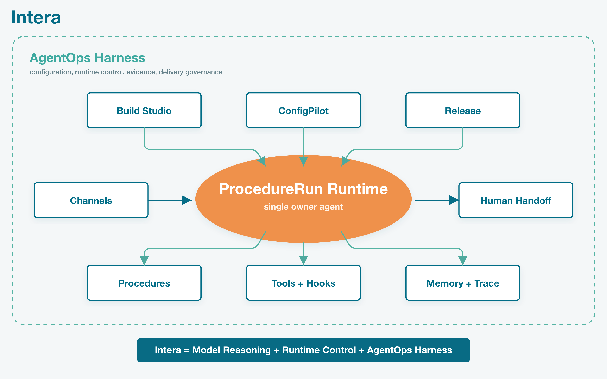

# Intera

<p align="center">
  
</p>

<p align="center">
  <strong>An agent-native control plane for building and operating customer-support AI.</strong>
</p>

<p align="center">
  <a href="LICENSE"></a>
  
  
  
</p>

Intera is an open-source reference implementation of an AI customer-support
platform built around **governed agent execution**. It connects model reasoning
to durable procedures, business tools, runtime hooks, human handoff, memory,
traces, validation scenarios, and reviewable releases.

The model is free to reason. The runtime decides what may execute, records what
happened, and keeps every customer-facing action attributable.

> 中文简介：Intera 是一套面向客服 Agent 的 AgentOps 控制平面，让模型推理、
> 业务工具、流程约束、人工接管和运行证据成为同一个可审计系统。

## Why Intera

Most agent products optimize for producing an answer. Customer support also
needs operational guarantees:

- a clear owner for each live conversation
- durable state across multi-turn procedures
- typed tools with hard pre- and post-execution controls
- structured forms and human escalation
- replayable scenarios before a configuration is released
- traces that explain decisions without exposing hidden provider payloads
- versioned configuration with review, activation, and rollback semantics

Intera treats those guarantees as the product, not as logging added around a
chatbot.

## Product Surface

| Area | Purpose |
| --- | --- |
| **Pilot Lab** | Build and refine an Agent through guided conversation and a trace-aware playground. |
| **Procedures** | Describe issue-specific handling while preserving model judgment. |
| **Tools & Hooks** | Connect business capabilities and enforce hard runtime checkpoints. |
| **Scenario Lab** | Exercise draft behavior and retain validation receipts. |
| **Operate** | Inspect conversations, ProcedureRuns, traces, memory, and human tasks. |
| **Release** | Review version diffs and control which Agent configuration is active. |
| **AgentOps Control Plane** | Give external coding agents scoped evidence, typed proposals, replay, and review APIs. |

## Runtime Model

<p align="center">
  
</p>

```text
Customer message
  -> channel adapter
  -> discovery
  -> ProcedureRun
  -> reasoning and tool selection
  -> Hook evaluation
  -> tool result and durable evidence
  -> customer reply or human handoff
```

A `Procedure` is a soft operational guide, not a rigid flowchart. A
`ProcedureRun` owns the changing state of one issue. `Hooks` form the hard
control layer around tool use and completion. Runtime input epochs prevent stale
tool results or stale generated text from advancing a conversation after newer
customer input arrives.

## Agent-Native By Design

Intera separates intelligence from authority:

1. **Models propose.** The Agent reasons, selects procedures, calls tools, and
   drafts responses.
2. **Runtime governs.** Typed contracts, ownership checks, hooks, and durable
   state decide what can happen.
3. **Evidence accumulates.** Messages, tool activity, traces, memory, human
   tasks, and scenario receipts remain inspectable.
4. **Changes are reviewable.** External coding agents submit typed draft
   proposals rather than mutating a live Agent directly.
5. **Humans retain control.** High-risk actions can be blocked, rewritten, or
   transferred with a structured internal brief.

## Repository Map

| Path | Contents |
| --- | --- |
| `apps/console` | Next.js operator console, APIs, channel adapters, and Agent workspaces |
| `apps/runtime` | Internal runtime service |
| `packages/runtime-core` | Shared execution and orchestration logic |
| `packages/shared` | Contracts, types, memory helpers, UI primitives, and Prisma schema |
| `templates` | Portable Agent template examples |
| `doc/spec` | Product architecture and design specifications |
| `scripts` | Validation, boundary checks, receipts, and operational tooling |

## Project Status

Intera began as a production-backed exploration of agent-native customer
support. The original hosted environment has been archived; this repository is
published as a code and architecture reference for further development. It does
not include tenant data, production credentials, or the archived production
environment.

## License

Licensed under the [Apache License 2.0](LICENSE).
