# Intera Current Roadmap

**Last updated:** 2026-06-10
**Status:** current checkpoint map after UI2-A/B/C. UI2-D visual QA, final gate, push/deploy, and first customer delivery remain ahead.
**Audience:** founder, architect, coding-team leads, zero-context coding agents.

This roadmap is the compact visual map from the earliest shipped project foundations through the current Foundation Reset and the remaining commercial-delivery checkpoints.

Legend:

- **Done**: shipped and verified locally or in prior receipts.
- **Active**: dispatched or ready to finish now.
- **Next**: should run after active cleanup/gates.
- **Deferred**: intentionally reserved after P0 commercial delivery.

```mermaid
flowchart TD
  classDef done fill:#e9f7ed,stroke:#5b9d67,color:#17351f,stroke-width:1px;
  classDef active fill:#fff4d8,stroke:#d59b38,color:#3d2b08,stroke-width:1px;
  classDef next fill:#e8f4ff,stroke:#4e8fc7,color:#12324a,stroke-width:1px;
  classDef deferred fill:#f3f4f6,stroke:#9ca3af,color:#374151,stroke-width:1px,stroke-dasharray: 4 3;
  classDef gate fill:#fce7e7,stroke:#c9635b,color:#4a1612,stroke-width:2px;

  subgraph P0["Origin and early product foundation"]
    A0["Product seed<br/>AI customer-service SaaS with autonomous Agent support"]:::done
    A1["LiveChat integration<br/>Connect external customer conversations into Intera"]:::done
    A2["Console redesign<br/>Move toward an AgentOps workbench instead of scattered admin pages"]:::done
    A3["Chat to Console migration<br/>One Next.js Console app owns UI, APIs, Agent engine, and channels"]:::done
    A4["Deployment foundation<br/>Self-hosted Ubuntu, Postgres, Caddy, demo.anytrans.ai"]:::done
    A5["Auth and org foundation<br/>Sessions, organizations, Google SSO, invite hardening"]:::done
  end

  subgraph P1["Pre-reset capability hardening"]
    B0["Knowledge and GPTBots setup<br/>Source binding, retrieval tests, topK/model controls"]:::done
    B1["LiveChat per-agent consolidation<br/>Channel config follows selected Agent"]:::done
    B2["Memory and compact redesign<br/>Chat memory, user profile, compact strategy foundation"]:::done
    B3["Playground and trace hardening<br/>Dry-run, trace sidebar, persistence, render hints"]:::done
    B4["Prompt/model page groundwork<br/>Shared prompt assembly and model config cleanup"]:::done
    B5["Safe local DB<br/>Stop relying on production DB for normal verification"]:::done
  end

  subgraph P2["Foundation Reset diagnosis and domain reset"]
    C0["Architecture review<br/>Identify structural debt and reset sequence"]:::done
    C1["Procedure additive phases 1-3<br/>Procedure fields, prompt path, case-scoped legacy activation"]:::done
    C2["Reset vocabulary decision<br/>Policy/Guardrail to Hook, Skill to Tool, stage/sub-agent retired"]:::done
    C3["UI direction decision<br/>Quiet Agent Studio, unified light-first Console"]:::done
  end

  subgraph P3["Foundation Reset implementation wave"]
    F1["F1 Hook contracts and schema<br/>Hook and HookBinding plus package contracts"]:::done
    F2["F2 HookEngine runtime<br/>PreToolUse, PostToolUse, Stop checkpoints"]:::done
    F3["F3 Tool trace vocabulary<br/>tool_call/tool_result normalization across streams and traces"]:::done
    F4["F4 Hooks admin<br/>Hook API/UI and old policies/guardrails compatibility redirects"]:::done
    F6["F6 Agent Template Package v1<br/>Initial .intera-agent.json import/export"]:::done
    F7["F7 Scenario soft gate<br/>Scenario CRUD, receipts, validation state, activation override"]:::done
    UX0["UX0 Quiet Agent Studio primitives<br/>Light-first tokens and reusable surface classes"]:::done
  end

  subgraph P4["Post-foundation product lanes"]
    U1["U1 IA shell<br/>Build, Operate, Settings routes and redirects"]:::done
    C1b["C1 Procedure Builder<br/>ProcedureStep Hook binding and Hook validation copy"]:::done
    R1["R1 inline Procedure dispatch<br/>dispatch_case_agent no longer spawns background sub-agent"]:::done
    U2["U2 Release command center<br/>Live, draft, receipts, package actions, diff viewer"]:::done
    U3["U3 initial Pilot Lab<br/>Scenario receipts and early ConfigPilot shell"]:::done
    B1b["B1 Brain memory workspace<br/>Memory strategy, Profile, Compact Test"]:::done
    R2["R2 physical legacy cleanup<br/>Remove Policy/stage/sub-agent/skill physical runtime leftovers"]:::done
    Q1["Q1 terminology sweep<br/>Hook/Tool/Procedure language, docs, i18n, redirects"]:::done
    Q2["Q2 light-first polish<br/>Designer sketch direction, logo/motion assets, responsive polish"]:::done
  end

  subgraph P5["Runtime, Pilot, package, and regression lanes"]
    P1c["P1 ConfigPilot typed flow<br/>Backend context, propose, apply, accepted draft writes only"]:::done
    R3["R3 ProcedureRun overlay<br/>Stable prompt/tools, runtime timeline, inputEpoch, remember/read memory"]:::done
    S2["S2 runtime-backed Scenario receipts<br/>Distinguish fixture validation from Agent runtime evidence"]:::done
    UP["U-Pilot Chat Cockpit<br/>Logged-in Pilot Lab with Pilot and Playground tabs"]:::done
    PKG1["PKG1 package completeness<br/>Scenarios, refs, required secrets, dry-run report, 5-version cap"]:::done
    BASE1["BASE1 core console regression<br/>Model/prompt, Knowledge, Playground text/image, Trace, Release sanity"]:::done
    Q3B1["Q3-B1 route truth<br/>Legacy admin/ops routes and nav align to target IA"]:::done
  end

  subgraph P6["Current and remaining P0 delivery checkpoints"]
    Q3BF["Q3-B Final cleanup<br/>Delete confirmed-unused UI, active docs truth, terminology cleanup"]:::done
    VC1["Version control UX implementation<br/>Release timeline, Live/Draft/Historical, cap guidance, safer actions"]:::done
    UI2A["UI2-A shared material system<br/>Primitives, shell chrome, sidebar, page chrome"]:::done
    UI2B["UI2-B Build surfaces<br/>Release, Pilot Lab, Components, Playground visual convergence"]:::done
    UI2C["UI2-C Operate, Settings, Auth<br/>Conversations, Handoff, Organization, Login, Org Picker"]:::done
    UI2D["UI2-D visual QA sweep<br/>Spacing, icons, states, mobile, reduced motion, screenshots"]:::active
    GATE["Final integration gate<br/>typecheck, tests, clean build, browser smoke, no stale active docs"]:::gate
    PUSH["Push main<br/>Sync origin/main after green integration gate"]:::next
    DEPLOY["Deploy or cherry-pick to deploy/main<br/>Run server health and production smoke"]:::next
    SMOKE["Production smoke<br/>Pilot, Playground, Release package, Knowledge, model/vision, Conversations"]:::next
    CUSTOMER["First customer delivery<br/>Import starter package, customize Agent, validate receipts, activate channel"]:::next
  end

  subgraph P7["Post-P0 / deferred hardening"]
    D1["ProcedureRun durability<br/>Redis/lease or schema-backed runtime for multi-instance/restart resilience"]:::deferred
    D2["Agent family schema<br/>Stable agentFamilyId instead of grouping versions only by name"]:::deferred
    D3["Security and permissions hardening<br/>Fine-grained roles, secrets workflow, audit workflows"]:::deferred
    D4["Marketplace<br/>Template registry, publisher metadata, licensing, paid package distribution"]:::deferred
    D5["Full integration migration<br/>Portable knowledge/integration provisioning beyond refs/requirements"]:::deferred
    D6["Advanced Hook lifecycle<br/>Broader lifecycle hooks, async handlers, permission workflows"]:::deferred
  end

  A0 --> A1 --> A2 --> A3 --> A4 --> A5
  A5 --> B0 --> B1 --> B2 --> B3 --> B4 --> B5
  B5 --> C0 --> C1 --> C2 --> C3
  C3 --> F1 --> F2 --> F3 --> F4 --> F6 --> F7 --> UX0
  UX0 --> U1 --> C1b --> R1 --> U2 --> U3 --> B1b --> R2 --> Q1 --> Q2
  Q2 --> P1c --> R3 --> S2 --> UP --> PKG1 --> BASE1 --> Q3B1
  Q3B1 --> Q3BF --> VC1 --> UI2A --> UI2B --> UI2C --> UI2D --> GATE --> PUSH --> DEPLOY --> SMOKE --> CUSTOMER
  CUSTOMER -. later .-> D1
  CUSTOMER -. later .-> D2
  CUSTOMER -. later .-> D3
  CUSTOMER -. later .-> D4
  CUSTOMER -. later .-> D5
  CUSTOMER -. later .-> D6
```

## Checkpoint Notes

| Checkpoint | Status | Brief |
|---|---|---|
| Product seed | Done | Define Intera as multi-tenant AI customer-service SaaS. |
| LiveChat integration | Done | Bring real customer chat into the Agent workflow. |
| Console redesign | Done | Shift from scattered admin pages toward AgentOps workbench. |
| Chat to Console migration | Done | Consolidate app UI, APIs, Agent engine, and channel bridge into Console. |
| Deployment foundation | Done | Self-hosted Ubuntu deployment and production health loop. |
| Auth and org foundation | Done | Sessions, organizations, invites, Google SSO, and basic multi-tenant boundaries. |
| Knowledge and GPTBots | Done | GPTBots source binding and retrieval-test foundation. |
| LiveChat per-agent config | Done | Channel behavior follows selected Agent config. |
| Memory and compact foundation | Done | Chat memory, user profile, compact strategy, and later Brain workspace base. |
| Playground and trace hardening | Done | Dry-run, Trace Sidebar, run evidence, and renderHint cleanup. |
| Safe local DB | Done | Safer verification foundation for coding lanes. |
| Architecture review | Done | Diagnosed debt and established Foundation Reset. |
| Procedure additive phases | Done | Earlier Procedure columns and prompt path used as migration input. |
| Foundation Reset F1-F7/UX0 | Done | Hook/Tool/Scenario/package primitives and light UI primitives. |
| U1/C1/R1 | Done | Target IA shell, Procedure Builder, and inline Procedure runtime. |
| U2/U3/B1 | Done | Release, first Pilot Lab, and Brain Memory workspaces. |
| R2/Q1/Q2 | Done | Physical legacy cleanup, terminology sweep, and light-first polish. |
| P1 | Done | ConfigPilot backend typed context/propose/apply flow. |
| R3 | Done | ProcedureRun runtime overlay, real memory tools, stable prompt/tool boundary. |
| S2 | Done | Runtime-backed Scenario receipts with fixture/runtime truth labels. |
| U-Pilot | Done | Pilot Lab becomes chat cockpit with Pilot and Playground tabs. |
| PKG1 | Done | Package completeness, import dry-run, refs/requirements, version cap. |
| BASE1 | Done | Core basics: model/prompt, Knowledge, Playground text/image, trace, package sanity. |
| Q3-B1 | Done | Route/nav truth: old admin/ops links point to target IA. |
| Q3-B Final | Done | Removed proven-dead UI, fixed compatibility case detail route, and aligned active docs/copy without deleting Playground runtime. |
| Version control UX | Done | Release now shows Agent-family timeline, live/draft/historical states, validation evidence, diff-vs-live context, action semantics, and 5-version retention guidance. |
| UI2-A shared material system | Done | Converged shell, sidebar, page chrome, and shared material primitives around the approved milky translucent light system. |
| UI2-B Build surfaces | Done | Applied the system to Release, Pilot Lab, Components, and Playground without changing IA or runtime behavior. |
| UI2-C Operate, Settings, Auth | Done | Applied the system to Conversations, Handoff, Organization, Login, and Org Picker. |
| UI2-D visual QA sweep | Active | Check collapsed/expanded/hover/active/selected/empty/loading/mobile states and final visual consistency. |
| Final integration gate | Next | Run full gates and browser smoke before push/deploy. |
| Push main | Next | Sync local integration branch after clean gates. |
| Deploy / production smoke | Next | Move validated main to deploy path and verify health plus real browser flows. |
| First customer delivery | Next | Import starter package, configure, validate receipts, activate real channel. |
| ProcedureRun durability | Deferred | Add Redis/lease or schema-backed active runtime state for multi-instance resilience. |
| Agent family schema | Deferred | Replace name-based version family grouping with stable identity. |
| Security and permissions | Deferred | Fine-grained roles, approvals, secrets, and audit workflows. |
| Marketplace | Deferred | Package registry, publisher metadata, licensing, and sales flow. |
| Full integration migration | Deferred | Move beyond refs into portable integration/knowledge provisioning. |
| Advanced Hook lifecycle | Deferred | Add broader lifecycle hooks, async handlers, and permission workflows. |

## Current Dispatch Guidance

1. Run **UI2-D visual QA sweep** from a checkout that contains `56628942`, `8d51737a`, and `bb4c6389`.
2. Run the **Final integration gate** before pushing or deploying.
3. Use the hotfix worktree only for live minimal repair; cherry-pick or adapt hotfixes back into main before final deployment.
