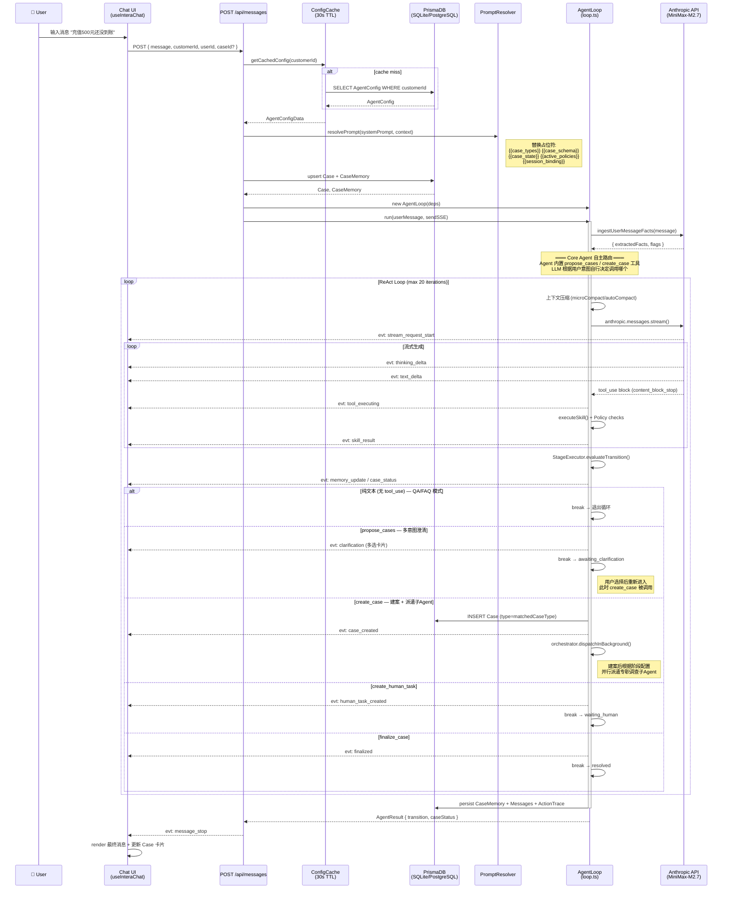
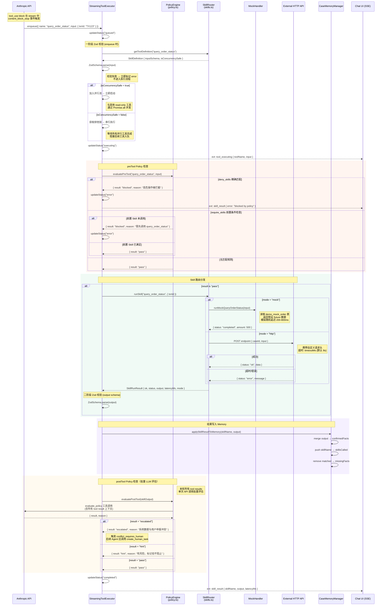
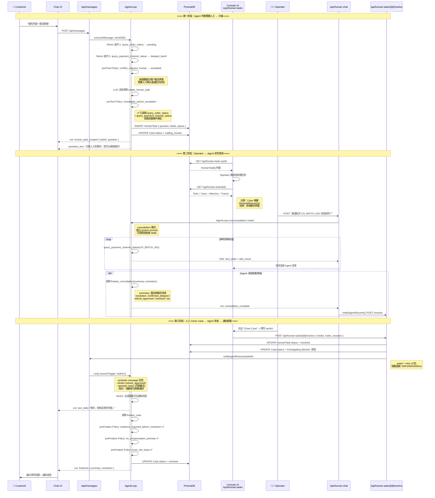
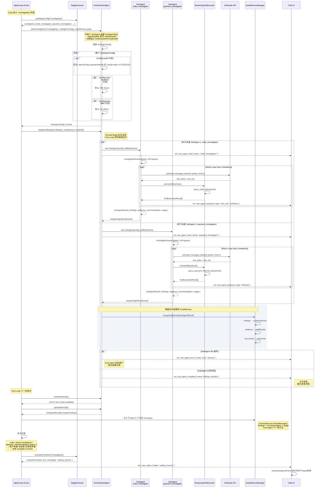

# Intera Agent — 系统时序图

> 基于 Intera Harness 架构文档 v1.1 (2026-05-13) 与核心代码库。
> 所有参与者名称、方法调用、SSE 事件类型均与实际代码一致。

---

## 图例

| 约定 | 含义 |
|------|------|
| `→` | 同步调用 / HTTP 请求 |
| `--→` | 异步通知 / SSE 推送 |
| `Note right of` | 关键决策点 / 边界条件 |
| `activate/deactivate` | 对象生命周期 |
| `alt/else` | 分支逻辑 |
| `par` | 并行执行 |

**SSE 事件类型前缀**：所有以 `evt:` 开头的内容对应实际 `SSEEvent.type` 枚举值。

---

## 1. 消息全链路流程 (Message Full Lifecycle)

用户从输入消息到获得 Agent 响应的端到端流程。**路由由 Core Agent 自行决定**：通过 `propose_cases`（多意图澄清）和 `create_case`（直接建案）两个内置工具，Agent 判断是纯 QA 对话还是需要创建 Case 并派遣子Agent调查。

---

## 2. Agent ReAct Loop 内部机制

AgentLoop 单次迭代的完整内部流程，展示阶段门控、工具执行、策略检查和上下文压缩的协作。

```mermaid
sequenceDiagram
    participant Agent as AgentLoop<br/>(loop.ts)
    participant Memory as CaseMemoryManager<br/>(memory.ts)
    participant StageEx as StageExecutor<br/>(stage-executor.ts)
    participant LLM as Anthropic API
    participant ToolEx as StreamingToolExecutor<br/>(streaming-tool-executor.ts)
    participant Policy as PolicyEngine<br/>(policy.ts)
    participant Skills as SkillRouter<br/>(skills.ts)
    participant Trace as TraceWriter<br/>(trace.ts)
    participant Orch as OrchestratorAgent<br/>(orchestrator.ts)
    participant DB as PrismaDB

    Note over Agent: runAgentTurn() 入口

    rect rgb(245, 245, 250)
        Note over Agent,Trace: 1) 上下文压缩阶段
        Agent->>Memory: microCompact(messages, minAgeMs=60s)
        Note right of Memory: 清理旧 tool_result<br/>保护新鲜缓存
        Agent->>Memory: sessionMemoryCompact()
        Memory-->>Agent: { shouldCompact, isBlocking }
        alt token > 40K (autocompact threshold)
            Agent->>LLM: compactConversation(messages)
            LLM-->>Agent: summary
            Memory->>Memory: 更新 L2 summary
        end
        alt token > 15K (blocking threshold)
            Agent->>Memory: snip(messages, keepRatio=0.65, keepMin=6)
        end
    end

    rect rgb(250, 245, 240)
        Note over Agent,Trace: 2) 用户消息写入
        Agent->>Memory: writeMessage(role=user)
        Agent->>Trace: writeTrace("user_message")
    end

    rect rgb(240, 250, 245)
        Note over Agent,Trace: 3) 事实提取
        Agent->>LLM: ingestUserMessageFacts(message)
        Note right of LLM: 调用 extract_facts 工具<br/>提取 txnId, amount, flags 等
        LLM-->>Memory: { extractedFacts, flags }
        Memory->>Memory: merge confirmedFacts<br/>remove from missingFacts
    end

    alt case.status === waiting_human
        Agent->>Agent: 发送通知，暂停，不进入 Agent
    end

    rect rgb(255, 250, 240)
        Note over Agent,Orch: 4) 子 Agent 派遣（首次进入阶段时）
        opt orchestrator.enabled && first iteration
            Agent->>StageEx: getStageConfig(currentStage)
            StageEx-->>Agent: { subAgents, requiredSkills, ... }
            Agent->>Orch: planInvestigation(stage, subAgentConfigs, memory)
            Orch-->>Agent: SubAgentTask[]
            Agent->>Orch: dispatchInBackground(tasks)
            Note right of Orch: 后台并行执行<br/>不阻塞主 Agent
        end
    end

    rect rgb(240, 245, 255)
        Note over Agent,LLM: 5) Transition-Driven ReAct Loop
        loop while iterationCount < maxIterations
            Agent->>StageEx: buildStagePrompt(currentStage, memory)
            StageEx-->>Agent: stageContextBlock
            Note right of StageEx: 注入阶段目标、证据要求<br/>已调用技能、缺失事实

            Agent->>StageEx: filterTools(currentStage, allTools)
            StageEx-->>Agent: allowedTools
            Note right of StageEx: 按阶段白名单过滤<br/>仅暴露当前阶段允许的工具

            Agent->>ToolEx: new StreamingToolExecutor(allowedTools)
            Agent->>LLM: anthropic.messages.stream({ system, messages, tools })

            par LLM 流式生成 + 工具即时执行
                loop 每个 content block
                    alt text_delta
                        LLM-->>Agent: SSE: text_delta
                    else thinking_delta
                        LLM-->>Agent: SSE: thinking_delta
                    else tool_use (content_block_stop)
                        LLM-->>ToolEx: enqueue(toolUse)
                        ToolEx->>ToolEx: updateStatus(queued)
                        alt isConcurrencySafe=true
                            ToolEx->>ToolEx: 加入并行队列 → 立即执行
                        else isConcurrencySafe=false
                            ToolEx->>ToolEx: 加入串行队列 → 等待排他锁
                        end
                    end
                end
            end

            ToolEx->>ToolEx: waitForAll()
            Note right of ToolEx: 等待所有入队工具完成<br/>并行工具 Promise.all<br/>串行工具逐一出队

            rect rgb(255, 240, 240)
                Note over ToolEx,Policy: 6) 每个工具结果的后处理
                loop 每个 completed tool
                    ToolEx->>Policy: evaluatePreTool(skillName)
                    Note right of Policy: deny_skills 精确匹配<br/>require_skills 前置检查
                    alt blocked
                        Policy-->>ToolEx: { result: "blocked", reason }
                    else pass
                        ToolEx->>Skills: runSkill(name, input)
                        Skills-->>ToolEx: SkillRunResult { ok, output, latencyMs }
                        ToolEx->>Memory: applySkillResultToMemory(output)
                        Memory->>Memory: merge confirmedFacts<br/>add to skillsCalled
                        ToolEx->>Policy: evaluatePostTool(skillOutput)
                        Note right of Policy: 批量 LLM 评估<br/>单次 API 调用覆盖所有结果
                        Policy-->>ToolEx: { result: "pass"|"hint"|"blocked"|"escalated" }
                        ToolEx->>Trace: writeTrace("skill_result")
                    end
                end
            end

            rect rgb(250, 240, 255)
                Note over Agent,StageEx: 7) 终端工具处理
                alt create_human_task
                    Agent->>DB: 创建 HumanTask, Case→waiting_human
                    Agent-->>Agent: break (transition: waiting_human)
                else finalize_case
                    Agent->>Policy: evaluatePreFinalize(facts, basis)
                    Policy-->>Agent: { result, reason }
                    opt preFinalize blocked
                        Agent->>Agent: continue (不退出, Nudge LLM)
                    end
                    Agent->>DB: Case→resolved
                    Agent-->>Agent: break (transition: resolved)
                else request_user_input
                    Agent-->>Agent: break (transition: waiting_form)
                else propose_cases
                    Agent-->>Agent: break (transition: awaiting_clarification)
                else propose_interaction
                    Agent-->>Agent: break (transition: awaiting_interaction)
                end
            end

            rect rgb(240, 250, 240)
                Note over Agent,StageEx: 8) 阶段转换评估
                Agent->>StageEx: evaluateTransition(currentStage, memory, skillResults)
                alt transition type = auto
                    StageEx->>StageEx: checkEvidenceRequirements()
                    alt all_evidence_gathered + all_skills_called
                        StageEx-->>Agent: { shouldTransition: true, nextStage }
                        Agent-->>Agent: SSE: case_status
                    end
                else transition type = evaluation
                    StageEx->>LLM: stage_transition_decision tool_use
                    Note right of LLM: Assistant pre-fill `{"` 强制 JSON<br/>3次解析失败 → 断路器降级
                    LLM-->>StageEx: { shouldTransition, nextStage, reason }
                    StageEx-->>Agent: TransitionEval
                else transition type = manual
                    StageEx-->>Agent: { shouldTransition: false }
                    Note right of StageEx: 仅人工触发<br/>(waiting_human/resolved)
                end
            end

            rect rgb(255, 250, 245)
                Note over Agent,StageEx: 9) Nudge 检查
                Agent->>StageEx: checkRequiredSkills(currentStage, skillsCalled)
                alt 缺失必需技能
                    StageEx-->>Agent: { met: false, missing: [...] }
                    alt nudgeCount < 3
                        Agent->>Agent: 注入 [SYSTEM NUDGE] 到下一轮
                        Note right of Agent: "You MUST call these tools.<br/>Do not just describe — call them."
                    else nudgeCount >= 3
                        Agent->>Agent: 升级为 human intervention
                    end
                end
            end

            alt LLM 返回纯文本 (无 tool_use)
                opt requiredSkills 已满足
                    Agent-->>Agent: break (正常结束)
                end
            end

            Agent->>Orch: hasNewResults()
            alt 有新结果
                Orch-->>Agent: SubAgentResult[]
                Agent->>Memory: merge sub-agent findings
            end
        end
    end
```

---

## 3. Skill 执行与 Policy 检查流程

单个 Skill 从 LLM 决定调用到完成结果回写的详细流程，展示并行/串行执行、Mock/HTTP 双模式和双重 Zod 校验。

---

## 4. Human-as-a-Tool 完整流程

人工不是"接管对话"，而是 Agent 背后的一个可调用资源。此图展示从 Agent 决定升级、Operation-Agent 咨询、到人工回执后 Agent 恢复并通知顾客的完整闭环。

---

## 5. Sub-Agent 并行派遣系统

当 Case 进入特定阶段（如 `investigating`），OrchestratorAgent 规划并派遣多个专职 SubAgent 并行执行调查任务，结果增量合并到 CaseMemory 供主 Agent 综合决策。

---

## 附录：SSE 事件类型速查

| SSE Event Type | 触发时机 | 方向 |
|----------------|----------|------|
| `stream_request_start` | LLM API 请求开始 | Agent → ChatUI |
| `thinking_delta` | LLM 扩展思考内容 | Agent → ChatUI |
| `text_delta` | LLM 生成文本片段 | Agent → ChatUI |
| `tool_executing` | 工具开始执行 | ToolEx → ChatUI |
| `skill_result` | 工具执行完成 | ToolEx → ChatUI |
| `case_created` | 自动建案成功 | Agent → ChatUI |
| `case_status` | 阶段转换发生 | Agent → ChatUI |
| `memory_update` | CaseMemory 变更 | Agent → ChatUI |
| `human_task_created` | 人工任务创建 | Agent → ChatUI |
| `consultation_complete` | 人工咨询结束 | HumanChat → ChatUI |
| `sub_agent_start` | 子Agent 开始执行 | Orch → ChatUI |
| `sub_agent_progress` | 子Agent 工具调用/思考 | SubAgent → ChatUI |
| `sub_agent_complete` | 子Agent 正常完成 | Orch → ChatUI |
| `sub_agent_error` | 子Agent 超时/失败 | Orch → ChatUI |
| `core_agent_progress` | 主Agent 迭代进度 | Agent → ChatUI |
| `form_request` | 动态表单请求 | Agent → ChatUI |
| `interaction_proposed` | 交互按钮卡片 | Agent → ChatUI |
| `clarification` | 多意图澄清 | Agent → ChatUI |
| `finalized` | Case 闭环成功 | Agent → ChatUI |
| `message_stop` | 消息生成结束 | MsgAPI → ChatUI |
| `error` | 错误发生 | Agent → ChatUI |
| `withheld` | 错误暂缓显示 | Agent → ChatUI |

---

## 附录：核心类与模块索引

| 文件 | 类/导出 | 职责 |
|------|---------|------|
| `apps/chat/lib/agent/loop.ts` | `AgentLoop` | 主 ReAct 循环引擎 |
| `apps/chat/lib/agent/stage-executor.ts` | `StageExecutor` | 阶段门控执行、转换评估、Nudge |
| `apps/chat/lib/agent/orchestrator.ts` | `OrchestratorAgent` | 子Agent 派遣规划、并行调度、增量合并 |
| `apps/chat/lib/agent/sub-agent.ts` | `SubAgent` | 隔离调查Agent，独立模型+工具集 |
| `apps/chat/lib/agent/streaming-tool-executor.ts` | `StreamingToolExecutor` | 流式工具执行，并行/串行调度 |
| `apps/chat/lib/agent/skills.ts` | `SkillRouter` | Skill 注册中心，mock/http 路由 |
| `apps/chat/lib/agent/policy.ts` | `PolicyEngine` | 策略引擎，preTool/postTool/preFinalize |
| `apps/chat/lib/agent/memory.ts` | `CaseMemoryManager` | 四层上下文管理，事实提取 |
| `apps/chat/lib/agent/trace.ts` | `TraceWriter` | 可观测性追踪写入 |
| `apps/chat/lib/agent/compact.ts` | `compactConversation` | LLM 对话压缩 |
| `apps/chat/lib/agent/microCompact.ts` | `microCompact` | 工具结果去重清理 |
| `apps/chat/lib/agent/prompt-resolver.ts` | `resolvePrompt` | 提示词占位符替换 |
| `apps/chat/lib/agent/config-cache.ts` | `getCachedConfig` | 30s TTL 配置缓存 |
| `apps/chat/app/api/messages/route.ts` | POST handler | 消息入口 API |
| `apps/chat/app/api/human-chat/route.ts` | POST handler | 人工咨询 API |
