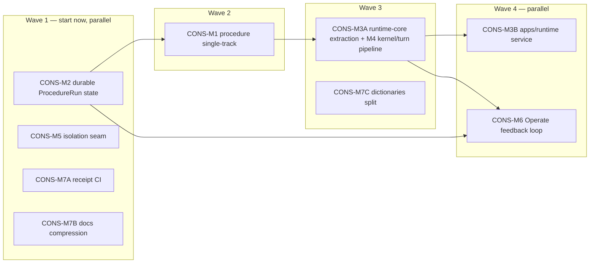

# Consolidation M1-M7 Execution Plan

**Status:** Owner-approved for construction dispatch (2026-06-12)
**Spec:** [`../spec/2026-06-12-architecture-consolidation-modules-spec.md`](../spec/2026-06-12-architecture-consolidation-modules-spec.md) — contracts, remove lists, and acceptance gates live there; this plan is the lane/task breakdown.
**Current execution contract:** this live plan is self-contained after docs compression. The older dispatch/audit docs in [`../archive/retired-handoffs/`](../archive/retired-handoffs/) are source history only; do not dispatch new work from archive files.
**Acceptance bar:** every lane requires local gates plus production proof on `https://demo.anytrans.ai`; screenshots/receipts are mandatory for UI-facing CRUD/test actions, J1B matrix runs, LiveChat round trips, runtime health, and Operate metrics proof.

> **For the dispatching architect:** dispatch by wave. Lanes inside a wave may run in parallel only with the owned-file declarations below. A lane prompt must (a) copy its module's task list and remove list as checkboxes, (b) expand tasks into red→green test-first steps before coding, (c) end with the lane's gates. Do not start a Wave-N lane while a blocking Wave-(N-1) lane is unmerged.

---

## 0. Wave Map: What Runs in Parallel, What Blocks



| Lane | Wave | Blocked by | May run parallel with | Why this position |
|---|---|---|---|---|
| CONS-M2 | 1 | — | M5, M7A, M7B | P0 stability fix; owns `schema.prisma` exclusively this wave |
| CONS-M5 | 1 | — | M2, M7A, M7B | API-plumbing only; zero overlap with runtime files |
| CONS-M7A | 1 | — | everything | scripts/CI only |
| CONS-M7B | 1 | — | everything | `doc/**` only |
| CONS-M1 | 2 | M2 merged | M7B | Shares `session-store.ts`, `loop.ts`, `schema.prisma` with M2 → must be sequential; lands on the persisted store so v2-only shape is what gets persisted |
| CONS-M3A+M4 | 3 | M1 merged | M7C | File moves + kernel extraction must happen on the single-track runtime, not the dual-track one |
| CONS-M7C | 3 | — (timing only) | M3A | `dictionaries.ts` is the #1 merge hotspot; schedule when no UI copy lanes are active |
| CONS-M3B | 4 | M3A merged | M6 | New files (`apps/runtime/**`, deploy units) + thin proxy edits |
| CONS-M6 | 4 | M2 (schema field), M3A (stable call sites) | M3B | Operate UI + metrics API + three terminal-transition call sites in runtime-core |

**Hard blocking rules (never violate):**

1. `packages/shared/prisma/schema.prisma` is sequential: M2 (Wave 1) → M1 (Wave 2). Never two schema lanes at once.
2. `apps/console/lib/agent/session-store.ts` and `loop.ts` chain: M2 → M1 → M3A/M4. No parallel edits to these files, including hotfixes — pause overlapping runtime hotfix work until the active integration branch has absorbed it.
3. M3B and M6 may run in parallel only with the exact owned-file split declared in their sections.
4. `package.json` is M5-owned in Wave 1. If M7A needs manifest/script wiring, land it through the coordinator after M5 merges or in a dedicated follow-up, not as a second parallel owner.
5. **Working-tree WIP gate:** `app/build/components/procedures/[name]/page.tsx` (and several docs) carry uncommitted changes as of 2026-06-12. Before Wave 2 starts, the coordinator must land or explicitly discard that WIP; CONS-M1 owns that file afterward.

**J1B regression economics (owner-approved default):** the full J1B scenario matrix re-run is bundled at two points — end of Wave 2 (after M1+M2, the runtime/prompt/procedure changes) and end of Wave 4 (after the process split). Individual lanes still run the targeted scenario suites listed in their gates. If any bundled re-run fails, the failing lane reopens.

---

## Current Integration Status (2026-06-16)

- `codex/cons-integration-m1-m7-full` stacks M1, M3A/M4, M6, M7C, and M3B on the current main baseline.
- Local proof on that branch: focused runtime/Console seam tests, `npm run test:runtime`, `npm test`, `npm run build:console`, `npx tsc --noEmit -p apps/console/tsconfig.json`, deploy script syntax checks, and `git diff --check` pass.
- Security proof: `next` is patched to `15.5.18`, clearing production high/critical Next audit findings; `npm audit --omit=dev` still reports a moderate advisory from Next's bundled `postcss@8.4.31`. Track the owner decision in [`../handoffs/DELIVERY_UNCERTAINTY_LOG.md`](../handoffs/DELIVERY_UNCERTAINTY_LOG.md).
- Production deploy status: `origin/main`, `deploy/main`, and the server worktree are at `c776a700fbea6c0e7d22d379074ea89115b7a310`; `https://demo.anytrans.ai/api/health` is healthy, public `/internal/health` is blocked, and unauthenticated `/api/operate/procedures/metrics` returns `401`.
- Authenticated Operate metrics proof: Chrome-authenticated production proof passed after `fix(operate): count legacy human handoff outcomes`; `/operate/procedures` rendered with no console warn/error, and the authenticated metrics API returned `totalRuns=118`, `handedOff=48`, `handoffRate=0.4067796610169492`, `unknownTerminal=5`. Receipt: `.artifacts/production-readiness/2026-06-16/authenticated-operate-procedures/summary.md`.
- Active Procedure UI proof: Chrome-authenticated production proof on `/build/components/procedures/deposit_not_credited` found no active UI copy matches for `confirmedFacts`, `requiredFacts`, `Procedure v1`, `procedureVersion`, `legacyFacts`, `collectedFacts`, `exposeConfirmedFacts`, `seedProcedureTodos`, or `renderProcedureSteps`, with console warn/error count `0`. Receipt: `.artifacts/production-readiness/2026-06-16/procedure-v1-ui-absence/summary.md`.
- Production readiness command: `PRODUCTION_READINESS_REQUIRE_FULL=1 npm run check:production-readiness` was rerun after the earlier deploy and failed by design because authenticated Procedure metrics proof and host-local runtime internal health were skipped. The authenticated metrics gap now has separate Chrome-session proof above; strict command still cannot pass until runtime host-local health is available or a cookie-based final run is provided. Receipt: `.artifacts/production-readiness/2026-06-16/051843/summary.md`.
- Runtime-service host proof: a one-shot user-mode smoke on the production host proved `apps/runtime` can start on `127.0.0.1:3101` and read Console internal health with the existing `INTERNAL_API_SECRET`. Formal systemd enablement is still blocked from this session because `sudo cp /etc/intera/console.env` requires a password; no env or unit changes were applied.
- Hotfix merge state: `codex/cons-m1-main-base` is patch-equivalent to `origin/main` (`git cherry` marks its only ahead commit as `-`), and `codex/playground-formresult-hotfix` currently has no product-code delta beyond `.artifacts/` receipt files. These branches are not active code blockers for the remaining production acceptance work.
- Not accepted yet: runtime dual-process service proof, LiveChat runtime round trip, and bundled J1B matrix PASS remain required before this consolidation can be called complete.

---

## 1. CONS-M2 — Durable ProcedureRun State (Wave 1, P0)

**Spec section:** M2 (§3). **Owned files:**

- `packages/shared/prisma/schema.prisma` + new migration `packages/shared/prisma/migrations/2026061200xx_add_procedure_run/**` (exclusive)
- `apps/console/lib/agent/session-store.ts`
- `apps/console/lib/agent/__tests__/unit/session-store.test.ts` (+ new `procedure-run-durability.test.ts`)
- `apps/console/app/api/messages/route.ts` (hydration call sites only)
- `doc/spec/Intera_Harness_架构梳理.md` (§3.3/§3.4 boundary update)

**Tasks:**

- [ ] T1. Schema: add `ProcedureRun` model exactly per spec §3.3 (id=runId, caseId, agentConfigId, procedureId, procedureVersion, status, inputEpoch, needsReconcile, currentStepId, outcome, `state Json`, timestamps, the two indexes) and `Case.runtimeInputEpoch Int @default(0)`. Generate migration; run against local Docker PG (verify `DATABASE_URL` is `localhost:5434` first).
- [ ] T2. Write-through adapter: every mutating export in `session-store.ts` persists after the in-memory mutation — `startProcedureRun`, `recordProcedureToolCall`, `recordProcedureToolResult`, `recordProcedureTextReply`, `recordProcedureConditionEvaluation`, `reconcileProcedureInput`, `finalizeProcedureRun`, and the `appendInputEventToActiveRun` path reached from `enqueueMessage`/`enqueueMessageOrCreate`/`recordInitialInputEvent`. Canonical-truth writes are **awaited** (single `persistRun(run)` helper serializing per runId; ordinary chat persistence stays as-is). `nextInputEpoch` increments `Case.runtimeInputEpoch` write-through.
- [ ] T3. Hydration: `getOrCreateSession` loads `ProcedureRun` rows with `status IN ('active','paused')` for the caseId into `procedureRuntime`, and `latestInputEpoch` from `Case.runtimeInputEpoch`. A hydrated `active` run re-enters as `active`; document-shape mismatches (future fields) tolerated via the existing state types.
- [ ] T4. Lifecycle truth: `cleanupStaleSessions` eviction marks an `active` run `paused` with `reason='session evicted'` (persisted) and keeps DB rows; `closeSession` on explicit case close marks remaining runs `cancelled`, `outcome='abandoned'`.
- [ ] T5. Red→green kill-and-resume test: start v2 run → `create_human_task` pauses → clear session map (simulated restart) → `human_task_result` input → run resumes with inputs/evidence/evaluations/timeline intact and epoch continuity. Plus: epoch-durability test (epoch N → evict → next input stamps N+1) and an invariant test asserting in-memory state deep-equals rehydrated state after each mutating call.
- [ ] T6. Update `Intera_Harness_架构梳理.md` §3.3 (remove "no Prisma ProcedureRun table" R3 boundary) and §3.4 (single-process amnesia assumption) to point at the consolidation spec M2.

**Gates:** typecheck · keyless tests · clean `build:console` · migration applies on a prod-snapshot copy · production receipt: restart `intera-console.service` mid-run on `demo.anytrans.ai`, resume conversation, ProcedureRun timeline shows continuity (screenshot + receipt JSON under `.artifacts/delivery-audit/<date>/cons-m2/`).

---

## 2. CONS-M5 — Isolation Seam Mechanization (Wave 1, P1)

**Spec section:** M5 (§6). **Owned files:**

- `apps/console/lib/api/define-route.ts`, `apps/console/lib/api/assert-agent-in-org.ts`
- the 11 admin sub-module route files currently calling `assertAgentInOrg` manually
- `scripts/check-isolation-seam.mjs` (new), `package.json` (test/ci script wiring)
- `apps/console/app/api/admin/tools/__tests__/cross-org-isolation.test.ts` (extend as template)

**Tasks:**

- [ ] T1. `defineRoute` accepts `scope: 'agent' | 'org'`; `'agent'` resolves `agentConfigId` from params/query/body conventionally and runs `assertAgentInOrg` before the handler (404 on mismatch, same semantics as today).
- [ ] T2. Migrate the 11 routes to declare `scope: 'agent'`; delete their hand-rolled assert calls.
- [ ] T3. CI guard `scripts/check-isolation-seam.mjs`: under `apps/console/app/api/admin/**`, any file containing `repo.raw` or direct `prisma.` access must declare `scope: 'agent'` in its `defineRoute` call or appear in a reviewed allowlist in the script. Wire into the standard test command.
- [ ] T4. Prove the gate red-first: add a temporary unguarded canary route, show the script fails CI, remove the canary, show green. Record both runs in the lane receipt.
- [ ] T5. Note in `GENERIC_HANDOFF`/lane-template docs: every new admin sub-module must ship a red→green cross-org test modeled on `cross-org-isolation.test.ts`.

**Gates:** typecheck · keyless tests (isolation suite green) · CI guard red-on-canary/green-after receipt · no behavior change on existing routes (route tests pass unmodified except the scope migration).

---

## 3. CONS-M7A — Receipts as CI Artifacts (Wave 1, P2)

**Spec section:** M7 (§8.2 first bullet). **Owned files:** `scripts/ci-receipts.mjs` (new), `scripts/smoke-console-auth.mjs` (reuse, no behavior change), `.artifacts/ci/**`, host scheduling note in `deploy/`.

Wave-1 ownership note: `package.json` stays with CONS-M5 in this wave to avoid dual manifest ownership. Any `ci:receipts` script wiring lands through the coordinator after M5 merges or in a dedicated manifest follow-up.

**Tasks:**

- [ ] T1. `scripts/ci-receipts.mjs`: run the scenario `runtime-runner` headless suite for each configured agent template, write receipt JSON + summary MD to `.artifacts/ci/<date>/`.
- [ ] T2. Playwright screenshot pass reusing the existing auth/smoke pattern for the golden-loop pages (Pilot Lab, Procedure editor, Operate), appended to the same bundle.
- [ ] T3. Scheduling: npm script + documented host cron/systemd-timer entry in `deploy/` (single host, no GH runner assumption). Two consecutive scheduled runs producing bundles without human action = done.
- [ ] T4. Update `BROWSER_SMOKE_RUNBOOK.md`: manual screenshot lanes remain only for new-surface acceptance, not regression.

**Gates:** two dated bundles produced unattended · runbook updated · zero changes to runtime code.

---

## 4. CONS-M7B — Docs Compression + Vocabulary Lock (Wave 1, P2; may continue through Wave 2)

**Spec section:** M7 (§8.2 bullets 2-3). **Owned files:** `doc/README.md`, `doc/handoffs/**` (moves/archive only), `doc/archive/**`.

**Tasks:**

- [ ] T1. Collapse read-first to ≤5 live docs: harness architecture doc, one roadmap, the single current dispatch doc, uncertainty log, and the consolidation spec. Everything labeled "source history" moves under `doc/archive/` with an index; links repaired.
- [ ] T2. Vocabulary lock: add to `doc/README.md` current vocabulary — `Procedure` is the only API/schema/runtime identifier; UI copy may render "Playbook" via i18n only. Add grep gate `rg -i "playbook" apps packages --type ts` (dictionary values exempt) to the final-sweep checklist.
- [ ] T3. Do not delete evidence: historical receipts keep old terminology per existing governance.

**Gates:** `doc/README.md` read order ≤5 live entries · all moved docs reachable from the archive index · no broken relative links (link-check pass).

---

## 5. CONS-M1 — Procedure Single-Track (Wave 2, P0; starts after M2 merges)

**Spec section:** M1 (§2) — the v1→v2 mapping table (§2.3) and remove list (§2.4) are normative. **Owned files:**

- `packages/shared/contracts/procedures.ts`, `packages/shared/contracts/case-types.ts`, `packages/shared/types/**` (procedure types)
- `packages/shared/prisma/schema.prisma` + migration (drop `ChatMemory.confirmedFacts`) — schema lane now free after M2
- `scripts/migrate-procedures-v1-to-v2.mjs` (new)
- `apps/console/lib/agent/procedure-executor.ts`, `tool-interceptor.ts`, `loop.ts`, `session-store.ts`, `memory.ts`, `message-builder.ts`, `prompt-resolver.ts`, `buildModePrompt.ts`, `hook-engine.ts` (requireFacts), `config-loader.ts`/`tools.ts` (KB tool identity)
- `apps/console/app/api/admin/case-types/**`, `apps/console/app/build/components/procedures/**`
- affected tests under `apps/console/lib/agent/__tests__/**`, `packages/shared/contracts/__tests__/**`

**Tasks:**

- [ ] T1. Migration script `scripts/migrate-procedures-v1-to-v2.mjs`: map every stored v1 `CaseType.procedure` to v2 per spec §2.3 (ask→ask; use/read→call_tool; escalate→request_human_handoff; finalize→end; decide/tag→step guidance; `when`→llm_eval branch or skipGuidance; required use/read→completionGuidance + tool_event safety check). Idempotent, `--dry-run` flag, preserves original under `legacy.procedureV1`. Verify on a prod-snapshot copy: 100% of rows parse as v2 afterward.
- [ ] T2. Write path v2-only: case-types routes + contracts accept only the v2 definition schema; v1 payloads rejected with an explicit error naming the migration script.
- [ ] T3. Runtime removals (spec §2.4 list, verbatim): v1 schema exports in `procedures.ts`/`case-types.ts`; `renderProcedureSteps`/`seedProcedureTodos`/`requiredToolTargets`/`isProcedureComplete` + the v1 `buildPrompt` path in `procedure-executor.ts`; `collectedFacts` branch in `tool-interceptor.ts`; `exposeConfirmedFacts` gate in `loop.ts`; `legacyFacts`/`buildLegacyStepTitle`/v1 `buildInitialSteps` branch in `session-store.ts`; ChatMemory-todo seeding (prove Pilot todos untouched).
- [ ] T4. Complete fin-spec §7.0.1: drop `ChatMemory.confirmedFacts` column + contracts + prompt blocks + `remember(scope="chat")` fact writes + Hook `requireFacts` + all route/receipt references. Run the spec's grep gates.
- [ ] T5. Knowledge Tool identity: KB tool names resolved from `KnowledgeSource` config at load time (config-loader/tool router); replace `toolName.startsWith('kb_search_')` in `v2ActionMatchesTool`.
- [ ] T6. Editor: v2-only authoring in `procedures/[name]/page.tsx`; remove v1 form remnants. (Pre-condition: the uncommitted WIP on this page has been landed or discarded by the coordinator.)
- [ ] T7. Gates + bundled J1B matrix re-run (end of Wave 2).

**Gates:**

```bash
rg "procedureVersion|isProcedureV2Definition|legacyFacts|collectedFacts|exposeConfirmedFacts" apps packages   # migration/archive hits only
rg "confirmedFacts|requireFacts|ingestUserMessageFacts" apps packages                                          # migration/archive hits only
rg "seedProcedureTodos|renderProcedureSteps" apps packages                                                     # clean
```

typecheck · keyless tests · clean build · migration verified on snapshot · production receipt: one migrated v2 procedure end-to-end on `demo.anytrans.ai` via the live editor · **bundled J1B matrix re-run PASS**.

---

## 6. CONS-M3A+M4 — runtime-core Extraction + Kernel/Turn Pipeline (Wave 3, one combined lane)

**Spec sections:** M3 step 1 (§4.2) + M4 (§5). One lane because the kernel extraction and the file moves touch the same modules; doing them separately doubles the churn. **Owned files:**

- `packages/runtime-core/**` (new) — destination for `apps/console/lib/agent/**` Next-free modules (loop, session-store, hook-engine, tool router + tools, trace, memory, compact/microCompact, stream/streaming-*, message-builder, prompt-selector/resolver, procedure-executor, procedure-llm-evaluator, persistence-port, identity, profiler, debug-logger)
- `packages/runtime-core/src/procedure-run-kernel.ts` (new)
- `apps/console/lib/agent/**` (deletions/re-exports), all import-path updates across `apps/console`
- new tests under `packages/runtime-core/__tests__/**`

**Tasks:**

- [ ] T1. Create `packages/runtime-core` workspace package; move the module list above; console imports the package (temporary re-export barrel at `apps/console/lib/agent/index.ts` allowed during the move, deleted before merge). Zero behavior change.
- [ ] T2. CI grep gate: no `next`, `next/*`, or `react` imports inside `packages/runtime-core` (script + test wiring).
- [ ] T3. Kernel: extract pure transitions from session-store into `procedure-run-kernel.ts` with `applyRunEvent(state, event, clock) -> { state, effects }` per spec §5.2; session-store becomes the adapter (storage write-through from M2, queue, TTL). Kernel file imports nothing impure — grep gate `rg "from '@intera/shared/prisma'|fetch\(|Date\.now" packages/runtime-core/src/procedure-run-kernel.ts` empty.
- [ ] T4. Kernel tests: table tests per transition + property test on the epoch invariant (*no step advance when `basedOnInputEpoch < state.inputEpoch`*).
- [ ] T5. Turn pipeline: restructure `AgentLoop.run` into `assembleContext → callModel → dispatchTools → runCheckpoints → persistTurn` named phases with explicit inputs/outputs; procedure overlay/memory/compaction plug at phase seams. Hard cap `wc -l loop.ts` ≤ 800 after the move.
- [ ] T6. Full runtime test suite + targeted scenario suite green; no behavior diffs.

**Gates:** both grep gates empty · property tests green · `loop.ts` ≤ 800 lines · typecheck/tests/build · targeted J1B smoke (full matrix re-run is bundled at end of Wave 4).

---

## 7. CONS-M7C — dictionaries.ts Split (Wave 3, parallel with M3A)

**Spec section:** M7 (§8.2 bullet 4). **Owned files:** `apps/console/lib/i18n/**` only.

**Tasks:**

- [ ] T1. Split `dictionaries.ts` (3,772 lines) into per-surface modules (`build.ts`, `operate.ts`, `settings.ts`, `common.ts`, per-locale) with a mechanical merge in `dictionaries.ts` preserving the existing lookup API. **No copy changes** — pure relocation, diff reviewable by key-count equality.
- [ ] T2. Key-count/equality test: merged dictionary deep-equals the pre-split snapshot.

**Gates:** equality test green · typecheck/build · zero rendered-copy diffs (spot screenshot).

---

## 8. CONS-M3B — apps/runtime Service (Wave 4)

**Spec section:** M3 step 2 (§4.2). **Owned files:**

- `apps/runtime/**` (new service), `deploy/intera-runtime.service` (new), `deploy/Caddyfile*` (internal routing), `deploy/console.env.example`
- thin-proxy edits only: `apps/console/app/api/messages/route.ts`, `apps/console/app/api/livechat/**` ingress
- **not owned:** `packages/runtime-core/**` internals (frozen except bugfix), Operate UI (M6's)

**Tasks:**

- [ ] T1. `apps/runtime`: long-lived Node service hosting runtime-core behind the internal API from spec §4.2 (`POST /internal/cases/:caseId/messages` SSE with today's event contract, `POST /internal/cases/:caseId/close`, `GET /internal/health` returning `{ sessions, activeRuns, queueDepth }`). Internal auth = shared token on the loopback/private network.
- [ ] T2. Console `/api/messages` and the LiveChat webhook route become authenticated thin proxies (auth/org/rate-limit stay in console; runtime trusts the internal token only).
- [ ] T3. Deploy: `intera-runtime.service` systemd unit + Caddy internal route; both processes share Prisma/PG. Document rollout/rollback in `deploy/`.
- [ ] T4. Receipts: console deploy while a run is mid-turn → turn completes, run state intact (M2 makes runtime restarts safe too — prove both). LiveChat webhook → runtime → reply round-trip on production.

**Gates:** two systemd units live · deploy-during-run receipt · LiveChat round-trip receipt · `/internal/health` reachable · **bundled J1B matrix re-run PASS (end of Wave 4)**.

---

## 9. CONS-M6 — Operate Feedback Loop (Wave 4, parallel with M3B)

**Spec section:** M6 (§7). **Owned files:**

- terminal-transition call sites in `packages/runtime-core` session-store adapter (`finalizeProcedureRun`, handoff pause, eviction/close) — coordinate the exact three functions with M3B owner before starting
- `apps/console/app/api/operate/procedures/metrics/route.ts` (new, `defineRoute` with org scoping per M5)
- `apps/console/app/operate/**`, `apps/console/components/operate/**`
- fixture + tests for the metrics endpoint

**Tasks:**

- [ ] T1. Outcome recording: `resolved_by_agent` (finalize passes safety checks), `handed_off` (human task created), `abandoned` (cancelled/expired/evicted) written to `ProcedureRun.outcome` at the terminal transition (column exists from M2).
- [ ] T2. Metrics API `GET /api/operate/procedures/metrics?from&to`: per `procedureId` — runs, resolution rate, handoff rate, abandonment, top blockers (frequency over `state.blockers`), median turns-to-terminal. Verified against a seeded fixture with hand-checked counts.
- [ ] T3. Operate UI: per-procedure table → run list → run detail (timeline, evidence, receipts, transcript link) → "Open playbook" CTA into the v2 editor.
- [ ] T4. Production receipt: a real handed-off J1B run shows the correct outcome and full drill-down path (screenshots per delivery-audit bar).

**Gates:** fixture counts match by hand · typecheck/tests/build · production drill-down receipt.

---

## 10. Standing Rules (apply to every lane)

- Two-phase verification: local gate first, production proof on `https://demo.anytrans.ai` second. Receipts under `.artifacts/delivery-audit/<date>/<lane>/`.
- Uncertain points and default decisions go to [`DELIVERY_UNCERTAINTY_LOG.md`](../handoffs/DELIVERY_UNCERTAINTY_LOG.md) as discovered.
- Record lane/integration status in this live plan or [`DELIVERY_UNCERTAINTY_LOG.md`](../handoffs/DELIVERY_UNCERTAINTY_LOG.md); archived handoff tables are historical evidence only.
- The freeze list (spec §9) is binding: no marketplace, no new Hook checkpoints, no workflow canvas, no new Pilot persistence models, no ConfigPilot expansion, no multi-instance work.
- Every lane executes its module's remove list **in the same lane** — deletion is not follow-up work.
