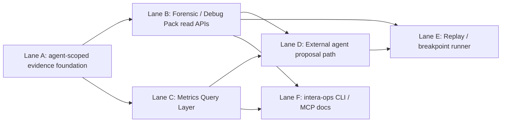

# AgentOps Harness MVP Execution Plan

**Status:** Active construction record (2026-06-26)
**Authoritative spec:** [`../spec/Intera_Harness_架构梳理.md`](../spec/Intera_Harness_架构梳理.md), especially §0 and §8.
**Purpose:** turn the AgentOps Control Plane direction into small construction lanes for coding agents. This plan does not replace the architecture spec; it is the execution split.

## Construction Coordination

**Coordination model:** the architect/coordinator owns architecture decisions, dispatch prompts, code review, integration judgment, and this construction record. Subagents own bounded exploration or implementation lanes. The user interacts only with the coordinator unless explicitly redirected.

**Current priority:** local-only AgentOps Harness Op MVP before any production-affecting rollout. The accepted vertical slice is Forensic Pack, Metrics, draft proposal intake, and local dry-run replay; Debug Trace Pack remains deferred behind stronger auth/audit/redaction.

### Dispatch Ledger

| Date | Agent | Scope | Mode | Status | Expected output |
|---|---|---|---|---|---|
| 2026-06-26 | Gibbs (`019f0316-7d0f-7ee2-bdd2-262b77d13303`) | Lane A: agent-scoped runtime evidence foundation | read-only explorer | completed | recommends no-schema read MVP using scope helpers; report attribution confidence; fix weak HumanTask write path separately |
| 2026-06-26 | Harvey (`019f0316-b259-7373-82e2-7baa566c8145`) | Lane B: Forensic Pack / Debug Trace Pack read APIs | read-only explorer | completed | recommends read-only `get_chat_forensic_pack` first; debug pack later with stronger auth/audit/redaction |
| 2026-06-26 | Aristotle (`019f0316-db30-76a2-a921-f3d8902ecd8d`) | Lane C: Metrics Query Layer | read-only explorer | completed | recommends read-only `/api/agentops/agents/[agentId]/metrics`, `resolveAgentCaseScope`, no schema/runtime changes |
| 2026-06-26 | Mendel (`019f031d-f849-7910-b633-770681ea17fc`) | Lane B1: Forensic Pack MVP | worker | completed / reviewed | new read-only forensic-pack route/service/contracts; route isolation test added after review |
| 2026-06-26 | Mill (`019f031e-69e4-78e1-af5b-32445949bee2`) | Lane C1: Metrics MVP | worker | completed / reviewed | new read-only metrics route/service/contracts; selected-agent and foreign-agent route tests pass |
| 2026-06-26 | Carver (`019f0333-3339-74e0-bf6b-f4862077e513`) | Lane A1: HumanTask durable attribution | worker | completed / reviewed | persists/repairs `orgId`, `chatId`, and active `runId` for `CaseAgentLoop` HumanTask/ChatMemory writes |
| 2026-06-26 | Linnaeus (`019f0333-5683-7fb2-b11f-3406d605f28b`) | AgentOps API quality audit | read-only explorer | completed | found two Forensic Pack P1 issues and one Metrics P2 contamination issue |
| 2026-06-26 | Avicenna (`019f0338-01f9-7540-84fb-518b9d7f54d1`) | Lane B2: Forensic Pack hardening | worker | completed / reviewed | fixed foreign LiveChat no-run inclusion and raw Tool output/error leakage |
| 2026-06-26 | Ramanujan (`019f0338-25e0-7433-a88c-4d0bab9b4a10`) | Lane C2: Metrics run-level scoping | worker | completed / reviewed | filters metrics evidence by selected-agent run ids; avoids fallback denominator contamination |
| 2026-06-26 | Hilbert (`019f0349-327d-70f1-844b-1f3d2f55b895`) | Local AgentOps entrypoint shape | read-only explorer | completed | recommended root `scripts/agentops-local.mjs` wrapper using session auth; defer MCP/OpenAPI/proposals/replay |
| 2026-06-26 | Dalton (`019f0349-4dab-7fc3-a254-18be7f126b41`) | Real local smoke design | read-only explorer | completed | recommended deterministic Prisma fixture plus real HTTP checks for metrics, forensic-pack, no-cookie, and fake-agent paths |
| 2026-06-26 | Halley (`019f0349-6c79-7443-9148-4561eb133194`) | Production-conflict audit | read-only explorer | completed | required loopback base URL, local DB guard, production marker rejection, and no SSH-tunnel DB port for new smoke |
| 2026-06-26 | Hypatia (`019f034e-3010-7da0-a7e0-f5910e97bcdf`) | Lane A2: active-run attribution guard | worker | completed / reviewed | only stamps `runId` on HumanTask/ChatMemory when active run belongs to the current `agentConfigId` |
| 2026-06-26 | Einstein (`019f034e-06c9-7333-b775-bced617b1617`) | Local AgentOps wrapper and smoke | worker | completed / reviewed | added `agentops:local` and `smoke:agentops` with deterministic local fixture, safety guards, and sanitized artifact summary |
| 2026-06-26 | Beauvoir (`019f0368-e845-7df0-87bd-f7dde50c3fcf`) | Draft proposal intake lane audit | read-only explorer | completed | recommended session-gated typed ConfigPilot proposal intake that persists drafted `PilotProposal` only |
| 2026-06-26 | Carson (`019f0369-091f-7ac1-8977-157716b09340`) | Replay dry-run lane audit | read-only explorer | completed | recommended return-only `local_dry_run` replay receipts with no runtime/provider/Tool execution |
| 2026-06-26 | Goodall (`019f0369-2b4e-72b0-9d43-6b4a11925208`) | Debug Trace Pack risk audit | read-only explorer | completed | recommended deferring Debug Pack until `read:debug_trace`, durable audit, redaction, and retention boundaries exist |
| 2026-06-26 | Epicurus (`019f036f-3cd8-7070-92fe-0c03785dd68a`) | AgentOps draft proposal intake | worker | completed / reviewed | added `POST /api/agentops/agents/[agentId]/proposals`; coordinator tightened persisted reason metadata validation |
| 2026-06-26 | Curie (`019f036f-9678-75c2-88a6-0be1e452a645`) | AgentOps local replay receipt | worker | completed / reviewed | added `POST /api/agentops/agents/[agentId]/replay`; coordinator made production runtime replay unconditionally forbidden |
| 2026-06-26 | Coordinator | Full local Harness Op smoke expansion | integration | completed | extended `smoke:agentops` to cover proposal, stale proposal, replay pass, replay blocked, fake draft, and leak scan |

### Integration Review - 2026-06-26

Accepted first read-only vertical:

- `GET /api/agentops/agents/[agentId]/chats/[chatId]/forensic-pack`
- `GET /api/agentops/agents/[agentId]/metrics`
- shared contracts under `packages/shared/contracts/agentops/**`
- service implementations under `apps/console/lib/agentops/**`

Review decisions:

- Both routes use `defineRoute({ scope: 'agent' })` and existing agent/case scope helpers.
- No schema, production, migration, or deployment changes were made.
- Runtime write-path changes are limited to durable `HumanTask`/`ChatMemory` attribution in `CaseAgentLoop`.
- Forensic Pack may read provider fields internally only to filter customer-visible transcript rows; provider/debug payloads are not returned.
- Debug Trace Pack remains deferred until `read:debug_trace`, redaction, audit logging, and retention boundaries are specified.
- Metrics keeps `cost` unavailable/null instead of inferring provider pricing.
- Metrics excludes synthetic Playground evidence by default and reports attribution/legacy coverage warnings.

Verification run by coordinator:

- `npx vitest run apps/console/lib/agentops/__tests__/forensic-pack.test.ts 'apps/console/app/api/agentops/agents/[agentId]/chats/[chatId]/forensic-pack/__tests__/route.test.ts'`
- `npx vitest run packages/shared/contracts/__tests__/agentops-metrics-contract.test.ts apps/console/lib/agentops/metrics.test.ts 'apps/console/app/api/agentops/agents/[agentId]/metrics/__tests__/route.test.ts'`
- `npx tsc --noEmit -p apps/console/tsconfig.json --pretty false`
- `npm test` guard scripts passed, then full Vitest failed in existing unrelated suites: React hook test environment failures, config-loader expectations, compact-route status expectations, and existing agent-scope/playground tests. AgentOps target tests remained green.

Open risks before widening:

- Exact-chat legacy rows with no `ProcedureRun`, no LiveChat metadata, and no playground agent prefix are excluded rather than guessed.
- Windowed metrics use existing message/task rows in the selected interval; long conversations that started before the window may need richer segment reconstruction later.

Quality audit findings requiring fixes before accepting the AgentOps read APIs:

- **P1:** Forensic Pack can include a no-run direct-answer LiveChat case stamped for another agent because alias/scope resolution is org-only and same-chat no-run evidence is widened as legacy.
- **P1:** Forensic Pack can echo raw Tool output/error strings from trace payloads. Forensic summaries must use redacted/allowlisted status, counts, keys, and generic result shapes.
- **P2:** Metrics aggregate by scoped case ids but do not filter trace/message/task rows by selected-agent run ids, so same-case sibling runs can contaminate token/tool/handoff metrics.

Resolution:

- B2 changed exact-chat no-run widening to inspect `ExternalConversation.metadata.agentConfigId`; foreign-agent metadata blocks inclusion instead of downgrading to legacy evidence.
- B2 changed Tool result summaries to shape-only summaries: counts, non-sensitive field names, status/error presence, string length, and scalar type.
- C2 filters message, HumanTask, and ActionTrace evidence by selected-agent `runIds`; `runId: null` evidence is included only for scoped cases without selected ProcedureRun ids.
- C2 also prevents handoff denominators from falling back to case `updatedAt` when all in-window evidence belongs to sibling runs.

Second review findings and resolution:

- **P1:** Local smoke checked DB SSH tunnels but not the console `baseUrl` listener. `smoke:agentops` now checks the base URL port with `lsof`, rejects SSH listeners, and records only sanitized listener command names.
- **P1:** Forensic Pack could leak raw `ActionTrace.detail` for unknown/future trace types. Unknown trace types are now dropped from timeline; known fallback summaries are generic rather than raw-detail based.
- **P1:** Forensic Pack included all `runId: null` evidence for a scoped case even when the selected agent had stamped ProcedureRuns. Forensic evidence now mirrors Metrics scoping: selected-run cases include only selected run ids; null-run and legacy-run evidence are included only for cases without selected-agent run ids.
- **P2:** Exact-chat no-run cases without metadata were widened into any selected agent in the org. Scope widening now requires matching `ExternalConversation.metadata.agentConfigId`; no-metadata cases stay excluded.
- **P2:** Real smoke did not prove existing same-org wrong-agent isolation. The fixture now creates `agentops-smoke-wrong-agent` and asserts its Forensic Pack request for the smoke chat returns 404.

Lane A1 review:

- Accepted `CaseAgentLoop.handleCreateHumanTask` durability patch.
- The patch writes existing `orgId`, resolved `chatId`, and active `ProcedureRun.runId` into `ChatMemory` and `HumanTask` create/update operations.
- It does not infer or persist `agentConfigId`.
- Verified with `npx vitest run apps/console/lib/agent/__tests__/unit/case-agent-loop-handoff-attribution.test.ts`, `npx vitest run apps/console/lib/agent/__tests__/human-handoff.test.ts apps/console/lib/agent/__tests__/unit/case-agent-loop-handoff-attribution.test.ts`, and `npx tsc --noEmit -p apps/console/tsconfig.json --pretty false`.

Post-hardening verification:

- `npx vitest run apps/console/lib/agent/__tests__/unit/case-agent-loop-handoff-attribution.test.ts apps/console/lib/agent/__tests__/human-handoff.test.ts apps/console/lib/agentops/__tests__/forensic-pack.test.ts apps/console/app/api/__tests__/agent-scope.test.ts 'apps/console/app/api/agentops/agents/[agentId]/chats/[chatId]/forensic-pack/__tests__/route.test.ts' packages/shared/contracts/__tests__/agentops-metrics-contract.test.ts apps/console/lib/agentops/metrics.test.ts 'apps/console/app/api/agentops/agents/[agentId]/metrics/__tests__/route.test.ts'`
- Result: 8 files, 33 tests passed.
- `npx tsc --noEmit -p apps/console/tsconfig.json --pretty false`
- `npm run check:migration-prefixes`
- `npm run check:isolation-seam`
- `npm run check:runtime-core-boundary`

### Local AgentOps Smoke - 2026-06-26

Accepted local entrypoints:

- `npm run agentops:local -- metrics --agent <agentId> ...`
- `npm run agentops:local -- forensic-pack --agent <agentId> --chat <chatId> ...`
- `npm run smoke:agentops`

Smoke safety rules:

- Base URL must be explicit loopback HTTP (`127.0.0.1` or `localhost`).
- `DATABASE_URL` must be `localhost` or `127.0.0.1`.
- Production markers such as the live host and live domain are rejected in base URL, DB URL, and environment values.
- `NODE_ENV=production` and `PRODUCTION_*` environment variables are rejected.
- The DB listener port is checked with `lsof`; an SSH tunnel on the DB port aborts the smoke.
- The console base URL port is checked with `lsof`; SSH listeners and non-dev listener commands abort the smoke.
- Smoke writes only to a deterministic local fixture and writes a sanitized summary under `.artifacts/agentops-smoke/**`.

Initial real smoke evidence:

- Local console: `http://127.0.0.1:3001`
- Local DB: throwaway Docker Postgres on `localhost:5433`, matching `apps/console/.env.local`; `AGENTOPS_ALLOW_NONSTANDARD_LOCAL_DB=1` was required because the repo default compose port is `5434`.
- Health: `/api/health` returned `{"status":"ok","db":"connected"}` before smoke.
- Command: `npm run smoke:agentops`
- Result: passed, 45 assertions, 0 failures.
- Summary artifact: `.artifacts/agentops-smoke/2026-06-26T10-08-21-719Z/summary.json`
- Route statuses: health 200, login 200, metrics 200, forensic-pack 200, no-cookie metrics 401, wrong-agent forensic-pack 404, fake-agent metrics 404.
- Listener preflight: console port `3001` listener command `node`; DB port `5433` listener command `com.docke`.
- Artifact leak scan passed for production markers, DB URL strings, and internal Tool/token sentinels.

Expanded full local Harness Op smoke:

- Added `POST /api/agentops/agents/[agentId]/proposals` to the smoke. The smoke reads `config-pilot/context` for the current draft fingerprint, posts one typed draft-only proposal, then checks local DB state: exactly one new drafted `PilotProposal`, refs-only AgentOps metadata, durable audit row, and unchanged active `AgentConfig`.
- Added stale proposal conflict coverage: wrong fingerprint returns `409` and creates no extra proposal.
- Added `POST /api/agentops/agents/[agentId]/replay` coverage for local observed evidence. Passing replay returns `agentops.replay-receipt.v1`, `mode=local_dry_run`, no provider/runtime Tool calls, no side effects, no Scenario receipt append, and no validation-state change.
- Added blocked replay coverage: observed `executionMode=runtime` Tool evidence returns a blocked receipt while still reporting no runtime execution was performed by the API.
- Added fake draft replay coverage: valid route agent plus missing `draftAgentConfigId` returns `404`.
- Real run: `npm run smoke:agentops` against throwaway Docker Postgres on `localhost:5433` and local console on `http://127.0.0.1:3001`.
- Result: passed, 98 assertions, 0 failures.
- Summary artifact: `.artifacts/agentops-smoke/2026-06-26T10-39-26-097Z/summary.json`.
- Route statuses: health 200, login 200, metrics 200, forensic-pack 200, config-pilot context 200, proposal 200, stale proposal 409, replay 200, blocked replay 200, fake draft replay 404, no-cookie metrics 401, wrong-agent forensic-pack 404, fake-agent metrics 404.
- Artifact leak scan passed for production markers, DB URL strings, session cookie markers, and internal Tool/token sentinels.

Proposal/replay review decisions:

- Draft proposal intake composes the existing ConfigPilot proposal schema instead of creating a second mutation language.
- Proposal intake is session-only owner/admin for now, `scope: 'agent'`, and persists only `PilotProposal.status='drafted'`; it does not call model propose, accept, apply, publish, activate, or runtime code.
- Persisted AgentOps metadata is refs-only. Coordinator tightened `reason` validation to reject secret-like values, DB URLs, and compact raw blobs.
- Replay accepts only `mode: 'local_dry_run'`, is owner/admin and agent-scoped, and returns receipts only.
- Replay is unconditionally disabled when `NODE_ENV=production`; no env override may re-enable it.
- Debug Trace Pack remains deferred. Do not implement a route stub that appears secure before scoped debug auth and durable audit exist.

### Review Gates

- No worker may touch schema/runtime write paths until the coordinator reviews Lane A's attribution audit.
- No worker may implement Debug Trace Pack payloads until `read:debug_trace`, redaction, audit, and retention boundaries are specified.
- No worker may widen mutation/proposal APIs beyond draft-only `PilotProposal` intake until the coordinator approves a scoped write model and human apply gate.
- Every implementation worker must declare owned files and "do not touch" files before editing.
- The coordinator reviews subagent diffs before any integration, test expansion, or production-proof discussion.

### Planned Worker Order

1. **Completed:** read-only contract skeleton for Forensic Pack and Metrics.
2. **Completed:** Forensic Pack MVP plus leakage/scope hardening.
3. **Completed:** Metrics MVP plus run-level scoping.
4. **Completed:** local `agentops:local` wrapper and real smoke guardrails.
5. **Completed:** draft-only AgentOps proposal intake with fingerprint conflict protection.
6. **Completed:** return-only local dry-run replay receipts.
7. **Deferred:** Debug Trace Pack until scoped debug auth, durable audit, redaction, and retention boundaries are specified.
8. **Deferred:** `intera-ops` MCP/OpenAPI packaging; local HTTP smoke is the current executable contract.

### Subagent Findings

#### Lane A Agent-Scoped Evidence Audit — 2026-06-26

Current attribution truth:

- `ProcedureRun.agentConfigId` is the strongest evidence anchor.
- `Case`, `Message`, `ActionTrace`, `HumanTask`, `ChatSession`, and `ChatMemory` do not directly store `agentConfigId`.
- `ExternalConversation.metadata.agentConfigId` attributes LiveChat direct-answer sessions when present.
- Playground `chatId` prefix `pg_${agentConfigId}_...` attributes playground runs.
- Scenario receipts are file-store bucket scoped by agent, not normal Prisma evidence.

Reusable scoping helpers:

- `apps/console/app/api/_agent-scope.ts`
- `resolveAgentCaseScope`
- `resolveAgentCaseScopeForChat`
- `resolveRequiredAgentCaseScopeForChat`
- `assertCaseInAgentScope`
- `caseIdFilterForScope`
- `childCaseIdFilterForScope`

Architect decision:

- First read-only AgentOps MVP may proceed without schema changes.
- Every Forensic/Metrics response must carry attribution status, such as `procedure_run`, `livechat_metadata`, `playground_prefix`, `legacy_or_unattributed`, or `unknown`.
- Aggregate metrics should count only agent-proven evidence by default.
- Direct-answer API chats with no `ProcedureRun`, no LiveChat metadata, and no playground prefix remain incomplete in MVP.
- Saved playground chats with `pg_saved_...` remain excluded unless later stamped or mapped.
- Do not backfill unknown rows to current active agent; leave them unknown.

Known weak write path:

- `apps/console/lib/agent/case-agent-loop.ts:CaseAgentLoop.handleCreateHumanTask` can create/update `HumanTask` without `orgId`, `chatId`, or `runId`.
- This should be a small safety-fix lane before relying on handoff metrics as complete.
- It is not required before a read-only Forensic Pack skeleton, but metrics must note possible incomplete legacy handoff rows.

Schema/backfill posture:

- Avoid schema changes for the first read-only MVP.
- If full coverage becomes required later, add nullable `agentConfigId` to `Case`, `Message`, `ActionTrace`, `HumanTask`, `ChatSession`, and probably `ExternalConversation`; backfill only where attribution is provable.
- Never make this a single `NOT NULL` production migration over large J1N message/trace tables.

Tests to require:

- same-org agent A/B same `chatId` scope test for `resolveAgentCaseScopeForChat`
- messages/traces routes exclude sibling-agent evidence and unattributable no-run rows unless metadata/prefix proves ownership
- `assertCaseInAgentScope` rejects shared-org/shared-chat unrelated cases
- `CaseAgentLoop.handleCreateHumanTask` persists `orgId`, `chatId`, and `runId`
- `/api/messages` rejects internal request with org A and agentConfigId from org B before runtime execution
- saved playground chat is stamped or excluded from agent-scoped lists
- run messages/traces routes do not leak sibling run evidence from the same case

#### Lane C Metrics Audit — 2026-06-26

Reusable code:

- `apps/console/app/api/operate/handoff/metrics/route.ts`
- `apps/console/lib/operate/handoff-metrics.ts`
- `apps/console/lib/operate/conversation-segments.ts`
- `apps/console/app/api/_agent-scope.ts`
- `apps/console/components/operate/conversation-metrics.ts`

Architect decision:

- First metrics MVP should be read-only and should not change schema, runtime write paths, replay, or config mutation.
- Use a new route shape: `GET /api/agentops/agents/[agentId]/metrics`.
- Scope through `resolveAgentCaseScope`; aggregate only over scoped `caseIds`.
- Default `includeSynthetic=false` so Playground/synthetic runs do not pollute production operational metrics.
- Return `cost: null` in MVP; do not invent provider pricing.
- Treat `handed_off` as an outcome, not automatically a failure.

Initial metric set:

- handoff rate
- first response latency, if trace-derived evidence is present
- tool error / timeout rate
- knowledge miss rate
- token summary
- top failing Procedure types, with conservative failure semantics

Tests to require before implementation acceptance:

- contract tests for metric query/window/defaults
- unit tests for denominator parity with current Operate handoff metrics
- route tests for selected-agent isolation and foreign-agent rejection
- cross-agent contamination test with mixed traces
- window boundary test, including `Asia/Shanghai`
- explicit `cost: null` test

#### Lane B Forensic / Debug Pack Audit — 2026-06-26

Reusable evidence surfaces:

- `apps/console/app/api/chats/[chatId]/route.ts`
- `apps/console/app/api/chats/[chatId]/messages/route.ts`
- `apps/console/app/api/chats/[chatId]/traces/route.ts`
- `apps/console/app/api/cases/[id]/**`
- `apps/console/app/api/runs/[runId]/**`
- `packages/runtime-core/src/provider-transcript.ts`
- `packages/runtime-core/src/trace-aggregator.ts`
- `apps/console/components/operate/conversation-metrics.ts`
- `apps/console/lib/operate/runtime-truth.ts`

Architect decision:

- First implementation slice is `get_chat_forensic_pack`, not Debug Pack.
- Add a narrow service at `apps/console/lib/agentops/forensic-pack.ts`.
- Add a route at `apps/console/app/api/agentops/agents/[agentId]/chats/[chatId]/forensic-pack/route.ts`.
- Put contracts under `packages/shared/contracts/agentops/**`.
- Reuse `resolveRequiredAgentCaseScopeForChat` and scoped chat/case/run/message/trace reads.
- Do not call runtime services, GPTBots, knowledge test APIs, compact/update-profile, save-to-chat, LiveChat, or any write path.
- Do not edit `apps/console/lib/agent/loop.ts`, `streaming-tool-executor.ts`, `tools.ts`, Hook runtime, or active J1N behavior for this slice.

`read:ops` safe fields:

- SaaS/operator links and stable ids
- customer-visible transcript only
- Case / ProcedureRun summary and timeline
- Tool summaries with non-secret selected args/results
- KB query/source/document/score/hit-miss summaries
- Hook decision summaries
- HumanTask / handoff status
- token/latency/model/provider summary
- redacted AgentConfig refs

`read:debug_trace` gated fields:

- `Message.providerContent`, `providerMeta`, and internal provider transcript rows
- full `llm_request_start` prompt/message/tool payloads
- full Tool args/results and backend ids
- raw KB ids and GPTBots responses
- Hook context/handler traces/source/config
- memory/procedure/config tails beyond redacted summaries

Redaction/audit requirements before Debug Pack:

- factor reusable redaction from `apps/console/lib/config-pilot/context.ts`
- use `isCustomerVisibleMessage` / `isInternalProviderMessage`
- strip internal memory keys and provider transcript markers
- call `writeAudit` for debug-pack reads with metadata only; never write raw prompts/transcripts/payloads to audit

## 0. Product Decision

Intera should not build an internal Codex-class ConfigPilot. Intera should expose an agent-native AgentOps Control Plane that lets human operators and external harness agents inspect production evidence, propose typed draft changes, replay incidents, and produce auditable receipts.

The first valuable slice is read-only operations evidence. Do not start with write automation or replay until Codex/Claude Code can reliably read scoped chats, traces, metrics, and config snapshots.

## 1. Dispatch Rules

- Every lane must read `doc/README.md`, `doc/spec/Intera_Harness_架构梳理.md`, `doc/handoffs/HARD_BUGS.md`, and `doc/handoffs/DELIVERY_UNCERTAINTY_LOG.md` first.
- Do not add raw production DB access, server shell access, filesystem debug-log reads, or direct active config mutation for external agents.
- All AgentOps reads and writes require explicit `agentId` / `agentConfigId` and org-agent ownership checks.
- Use typed contracts and zod validation. Prefer existing `defineRoute` patterns.
- Writes must create draft proposals with evidence refs, diff, audit, validation state, and rollback/reverse path.
- If a lane changes schema, include migration/backfill notes and red->green scope tests.

## 2. Lane Map



Fastest product validation path: Lane A partial audit -> Lane B read-only Forensic Pack -> Lane C metrics. This proves the "Codex can diagnose real incidents" workflow before any mutation is exposed.

## 3. Lane A — Agent-Scoped Runtime Evidence Foundation

**Goal:** every chat, message, trace, human task, and runtime evidence bundle can answer which org, agent config, agent family, and version/fingerprint produced it.

**Typical owned files:**

- `packages/shared/prisma/schema.prisma`
- `packages/shared/contracts/**`
- `apps/console/lib/api/**`
- `apps/console/app/api/messages/route.ts`
- `apps/console/lib/agent/**`

**Required behavior:**

- `ProcedureRun.agentConfigId` remains canonical for runs.
- General FAQ chats and pre-ProcedureRun conversations must still be attributable to an agent.
- New AgentOps APIs must not read org-wide rows then filter client-side.
- Cross-org / cross-agent tests must fail before the guard and pass after.

**Acceptance gates:**

- scope tests for every new/changed AgentOps route
- `npm run check:isolation-seam`
- targeted Vitest route/contract tests
- typecheck/build when schema or route contracts change

## 4. Lane B — Forensic Pack / Debug Trace Pack Read APIs

**Goal:** given `agentId` and `chatId`, return an incident bundle that a harness agent can use to diagnose customer feedback without guessing.

**Typical owned files:**

- `apps/console/app/api/agentops/agents/[agentId]/chats/[chatId]/forensic-pack/route.ts`
- `apps/console/app/api/agentops/agents/[agentId]/chats/[chatId]/debug-pack/route.ts`
- `apps/console/lib/agentops/**`
- `packages/shared/contracts/agentops/**`

**Forensic Pack fields:**

- SaaS conversation link
- original transcript and optional translated transcript request flag
- ProcedureRun state and timeline
- Tool calls, selected args/results, and render hints
- Knowledge retrieval query/docs/chunks/scores/miss indicators
- Hook decisions and risk flags
- HumanTask / handoff events
- token, latency, cost, and model/provider summary
- Agent config snapshot refs

**Debug Trace Pack fields:**

- provider request/response refs or payloads when authorized
- visible Tool schema snapshot
- prompt / procedure / memory / ProcedureRun tail
- Tool args/results
- retrieval raw evidence
- `inputEpoch`, timing, token, and cost details

**Security requirements:**

- `read:debug_trace` is distinct from ordinary `read:ops`.
- PII and secret refs must be redacted by policy.
- Every debug-pack read is audited.

## 5. Lane C — Metrics Query Layer

**Goal:** let external agents answer scoped operational questions such as "last 20m handoff rate" without raw SQL.

**Typical owned files:**

- `apps/console/app/api/agentops/agents/[agentId]/metrics/route.ts`
- `apps/console/lib/agentops/metrics.ts`
- `packages/shared/contracts/agentops-metrics.ts`

**Initial metrics:**

- handoff rate
- first response latency
- tool error / timeout rate
- knowledge miss rate
- token and cost summary
- top failing Procedure types

Each metric must define window, denominator, filters, timezone, and scope.

## 6. Lane D — External Agent Proposal Path

**Goal:** Codex/Claude Code can create a reviewable draft proposal with evidence refs and co-author audit, but cannot mutate active config.

**Typical owned files:**

- `apps/console/lib/config-pilot/contracts.ts`
- `apps/console/lib/config-pilot/apply.ts`
- `apps/console/lib/pilot/persistence.ts`
- `apps/console/app/api/admin/config-pilot/**`
- `apps/console/app/api/agentops/agents/[agentId]/proposals/**`
- Pilot Lab proposal/diff UI surfaces

**Required behavior:**

- reuse existing ConfigPilot patch surfaces: `brain`, `procedures`, `tools`, `hooks`, `hookBindings`, `knowledge`, `integrations`, `scenarios`
- store `externalAgent`, `evidenceRefs`, and safe `reason` metadata; keep reverse/rollback metadata for later apply/release work
- active version remains unchanged
- draft proposal intake does not change Scenario validation state; apply/draft mutation paths are responsible for marking validation stale

## 7. Lane E — Replay / Breakpoint Runner

**Goal:** replay a real incident against active or draft configuration and emit assertion receipts.

**Typical owned files:**

- `apps/console/lib/scenarios/**`
- `apps/console/app/api/admin/pilot/validation/**`
- `apps/console/app/api/agentops/agents/[agentId]/replay/**`
- `apps/console/lib/agentops/replay/**`

**Initial replay targets:**

- local observed evidence receipt with `mode=local_dry_run`
- chat-to-scenario generation
- provider-call breakpoint replay
- active-vs-draft comparison
- Tool argument assertion, e.g. `tool.get_latest_deposit.input.gmt=+5`
- KB retrieval assertion, e.g. expected doc/chunk was retrieved

Replay must not call side-effecting production Tools. Acceptance is receipt-based, not based on subjective answer quality.

## 8. Lane F — `intera-ops` CLI / MCP / Docs

**Goal:** provide the external harness-agent entry point.

**Typical owned files:**

- `packages/intera-ops-cli/**`
- `packages/intera-ops-mcp/**`
- `doc/agentops/AGENTS.md`
- `doc/agentops/SKILL.md`
- `doc/agentops/openapi.yaml`

**Target commands:**

```bash
intera ops login
intera ops agents
intera ops select-agent j1b-prod
intera ops metrics --window 20m --metric handoff_rate
intera ops chat Axxx --forensic-pack --translate zh
intera ops debug Axxx --provider-calls
intera ops propose tool update get_latest_deposit --field description --evidence chat:Axxx
intera ops replay chat Axxx --draft latest --assert tool.get_latest_deposit.input.gmt=+5
```

Login should use browser/device-code auth and short-lived scoped tokens. Do not ask agents to collect SaaS passwords in chat.

## 9. First Dispatch Prompt

Use this as the first coding-agent task. It is planning only.

```text
Read the Intera docs and AgentOps Harness MVP plan:

- doc/README.md
- doc/spec/Intera_Harness_架构梳理.md
- doc/handoffs/HARD_BUGS.md
- doc/handoffs/DELIVERY_UNCERTAINTY_LOG.md
- doc/to-do/2026-06-26-agentops-harness-mvp-execution-plan.md

Do not modify code.

Produce a construction plan with:
1. proposed lanes in execution order
2. owned files per lane
3. files that must not be touched by each lane
4. required schema/API/contract changes
5. migration risks
6. exact tests/gates per lane
7. red->green tests to add first
8. missing acceptance criteria

Be concrete and repo-relative.
```

## 10. Standard Lane Dispatch Template

```text
You are implementing one narrow Intera AgentOps Harness lane.

Authoritative docs:
- doc/README.md
- doc/spec/Intera_Harness_架构梳理.md
- doc/to-do/2026-06-26-agentops-harness-mvp-execution-plan.md
- doc/handoffs/HARD_BUGS.md
- doc/handoffs/DELIVERY_UNCERTAINTY_LOG.md

Lane:
<LANE NAME>

Goal:
<1-3 sentences>

Owned files:
<explicit paths/directories>

Do not touch:
<explicit paths/directories>

Required behavior:
- <acceptance criterion 1>
- <acceptance criterion 2>
- <acceptance criterion 3>

Implementation rules:
- Use typed contracts and zod validation.
- Require explicit agentId/agentConfigId and verify org ownership.
- No direct production DB credentials, server shell, or filesystem debug-log reads.
- No active AgentConfig mutation; writes must create draft proposals only.
- Preserve current vocabulary: Procedure, Tool, Hook, Scenario, AgentConfig.
- If introducing a route, add route tests and scope tests.
- If changing schema, include migration/backfill notes and tests.

Verification:
Run narrow tests first, then typecheck/build/full tests when feasible.

Final response must include changes, files changed, tests run, skipped tests, risks, follow-ups, and acceptance evidence.
```
